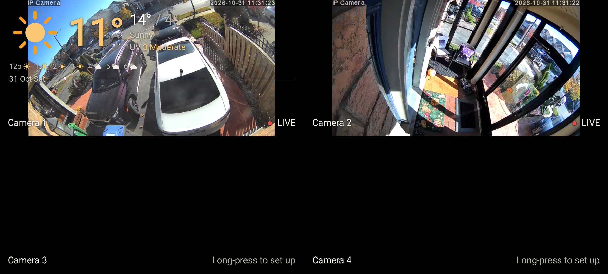

# Home View

An Android 10+ tablet & dashboard app that displays live security camera feeds (supporting both **H.264** and **H.265/HEVC** via LibVLC) in a 2×2 grid, overlaid with a floating, transparent Brampton weather widget and Google Calendar events.



---

## Features

- **2×2 Live Camera Grid**: Tap any camera to view full-screen HD, or tap again to return to the grid.
- **Smart RTSP Auto-Discovery**: Automatically tests and falls back through standard IP camera stream paths (`/live/ch0`, `/11`, `/stream1`, `/onvif1`, etc.) to guarantee connection.
- **LibVLC Engine**: Natively supports both H.264 and H.265/HEVC RTSP video streams.
- **Weather & Calendar Overlay**: Real-time Open-Meteo weather updates and upcoming Google Calendar iCal events.
- **Draggable & Persistent Weather Box**: Drag the weather widget to any corner; it snaps and remembers your preferred corner.
- **Kiosk & Boot Mode**: Can be set as the default launcher home screen to boot straight on power-up.

---

## 1. Setup & Configuration

- **Settings Access**: Opens automatically on first launch. Afterwards, **long-press any camera tile** (or the weather box) to open settings.
- **Top & Bottom Save Buttons**: Save settings instantly from the top or bottom of the form.
- **Cameras**: 
  - Default IP addresses (`10.0.0.173` and `10.0.0.209` for Cameras 1 & 2).
  - RTSP Port: `554`.
  - Username / Password: leave blank if anonymous access / RTSP Permission check is off, or enter your camera credentials.
- **Google Calendar**: Paste your Secret iCal address (from Google Calendar settings → Integrate calendar), one link per line.
- **Weather Location**: Latitude/Longitude (Brampton, ON by default).

---

## 2. Building the APK

### Option A: GitHub Actions (Free & Cloud-built)
1. Push your project to a GitHub repository.
2. Go to the **Actions** tab on GitHub. The **Build and Release APK** workflow runs automatically on every push.
3. Once completed (green check), download the **HomeView-apk** artifact from the workflow run to get `app-debug.apk`.

### Option B: Android Studio
Open the project in Android Studio and select **Build → Build Bundle(s) / APK(s) → Build APK(s)**.

---

## 3. Publishing & Releasing APKs on GitHub

To automatically publish a compiled APK as a downloadable **GitHub Release**:

1. Create and push a version tag (e.g., `v1.0.0`) from your terminal:
   ```bash
   git tag v1.0.0
   git push origin v1.0.0
   ```
2. GitHub Actions will automatically compile the APK and publish a **GitHub Release** under your repository's **Releases** page, attaching `app-debug.apk` with auto-generated release notes for your users to download directly.

---

## 4. Installation & Troubleshooting

- **Install**: Copy `app-debug.apk` to your tablet, tap to install, and allow **Install unknown apps** when prompted.
- **"Offline · retrying"**: 
  - Ensure your tablet is on the same local network as your cameras.
  - Verify the camera's IP address (e.g., `10.0.0.173`).
  - Ensure **RTSP Permission check** on the camera matches whether you entered credentials in the app.
  - Make sure your camera uses H.264 or H.265 video encoding.
